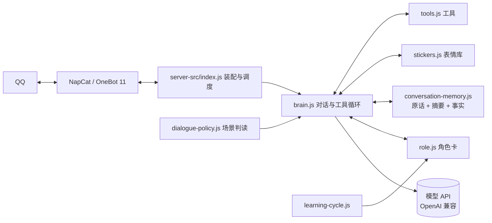

# QQ Agent

住在本机、跑在 QQ 里的对话角色。NapCat 把 QQ 消息转成 OneBot 协议，一个 Node 服务负责调度，模型负责说话，而**你是谁、怎么说话，全部写在你自己那份角色卡里**。

想做成什么性格都行 —— 助手、店长、病娇、老同学、某个虚构角色。代码不预设任何人设。

## 它能做什么

| 能力 | 说明 |
| --- | --- |
| 私聊 / 群聊 | 唤醒判定（叫名字、被 @、引用回复）、群聊读 96 条上下文 |
| 场景判读 | 每轮先用小模型判断是闲聊、接话还是认真回答，决定思考强度；失败则按原话正常回复 |
| 拟人节奏 | 打字速度按字数模拟，多段消息分气泡，最多连发 3 条，不会一口气刷屏 |
| 群聊接话 | 群里冷场或有人 @ 时按概率加入，有静默时段与频率上限 |
| 主动私聊 | 长时间没人说话时主动找主人，每天有次数上限 |
| 长期记忆 | 按会话存原话、滚动摘要、关键事实；可检索、可归纳成习惯 |
| 自我学习 | 每两小时读一遍聊天，把说话习惯提炼进角色卡的学习区（不记名字、不记隐私） |
| 表情与图片 | 收图入表情库、按语境发表情、动图抽帧判断内容、支援头像替换 |
| 工具调用 | 搜索、天气、时间、记事、查人；只对主人开放读文件 / 写文件 |
| 主人指令 | 私聊 `/状态`、`/学习 on\|off`、`/重读角色卡` 等 |
| 防泄露 | 模型输出里出现密钥、路径、内部配置时拦截整条消息 |

## 架构



## 目录

```
server-src/          运行时源码、测试与示例角色卡
  index.js           装配、配置校验、启动
  brain.js           一轮对话：场景判读 → 调模型 → 工具 → 拦截 → 发送
  role.js            读 role.md，拼系统提示词
  conversation-memory.js  会话状态、原话、摘要、事实、情绪
  learning-cycle.js  定时学习，写角色卡学习区
  dialogue-policy.js 场景判读与策略
  stickers.js        表情库
  transport-onebot.js 收发、断线补历史、合并转发
  tools.js           工具实现与权限
  group-*.js         群上下文、接话、说话习惯
tools/companion-control.ps1   启停与健康检查
config.example.json           配置模板
role.example.md               角色卡模板
data/public-memes.json        公开梗库（可选）
```

## 快速开始

1. 装 Node.js ≥ 18。
2. 装 [NapCat](https://github.com/NapNeko/NapCatQQ)，用一个小号登录，开启 HTTP 3000 与正向 WebSocket 3001，记下 access token。
3. 复制配置并填好：

   ```bash
   cp config.example.json config.json
   ```

   必填：`apiKey`、`baseUrl`、`model`、`names`（机器人叫法，第一个当署名）、`ownerIds`（主人 QQ）、`onebot.accessToken`。
4. 写角色卡：

   ```bash
   cp role.example.md role.md
   ```

5. 先干跑，确认配置和角色卡没问题：

   ```bash
   node server-src/index.js --check --config ./config.json
   node server-src/index.js --dry-run --config ./config.json
   ```

6. 正式启动（或 `pwsh -File tools/companion-control.ps1 -Action start`）。
7. 用主人 QQ 私聊发 `/状态` 验证链路。

## 角色卡

`role.md` 不在仓库里 —— 它是你的私房设定。模板见 `role.example.md`，四块：你是谁、怎么说话、情绪与关系、边界。写得越具体，它越像那个人。

改完重启服务，或私聊 `/重读角色卡` 让它当场重读。

## 配置要点

- `names` / `keywords`：被叫到就醒；`names[0]` 同时是消息署名。
- `wake`：什么条件下在群里醒（`groupAtOnly` 只认 @）。
- `limits`：每分钟最多几条、连发几段。
- `thinking`：哪个时段用高思考强度。
- `proactive` / `groupChime`：主动私聊与群聊接话的频率、静默时段。
- `learning`：开不开定时学习、间隔几小时。
- `tools`：工具轮数上限；文件读写只在主人私聊可用。
- `onebot.mounts`：NapCat 在容器里时的路径映射，默认 `/opt/napcat/...`。

不要提交 `config.json`、`role.md`、`data/`、`local/`：`.gitignore` 已经挡住了。

## 测试

```bash
node server-src/run-tests.mjs
```

242 个用例，覆盖场景判读、记忆、拦截、表情、群聊、工具、动图抽帧等。不需要模型与 QQ：网络全部 mock，素材在 `server-src/fixtures/`。

## 模块地图

| 文件 | 职责 |
| --- | --- |
| `index.js` | 装配依赖、校验配置、起 WebSocket |
| `brain.js` | 一轮对话主流程与工具循环 |
| `dialogue-policy.js` | 场景判读、思考强度、措辞清洗 |
| `role.js` | 角色卡拼接 |
| `conversation-memory.js` | 会话文件、摘要、事实、情绪 |
| `learning-cycle.js` | 定时把聊天提炼成习惯 |
| `stickers.js` / `media.js` | 表情库与图片解码 |
| `transport-onebot.js` | OneBot 收发、补历史、合并转发 |
| `tools.js` | 工具实现与主人权限 |
| `identity.js` | 机器人的名字（配置决定，缺省「机器人」） |

## 隐私与安全

- 角色卡、配置、运行数据都不进仓库。
- 密钥、绝对路径、内部机制出现在模型输出里会被整条拦截。
- 文件读写、改头像等敏感工具只对主人私聊开放。
- 日志会脱敏 `apiKey`、token。

## 已知限制

- 主要在 Windows 上开发与验证，Linux 下请自行确认 NapCat 路径与进程管理。
- 学习区提炼依赖模型质量，建议每两小时最多一次。
- 单机单进程：记忆存本地 jsonl，不做多实例共享。
- 不支持看视频内容，动图只抽帧看画面。

## 许可

MIT，见 [LICENSE](./LICENSE)。
